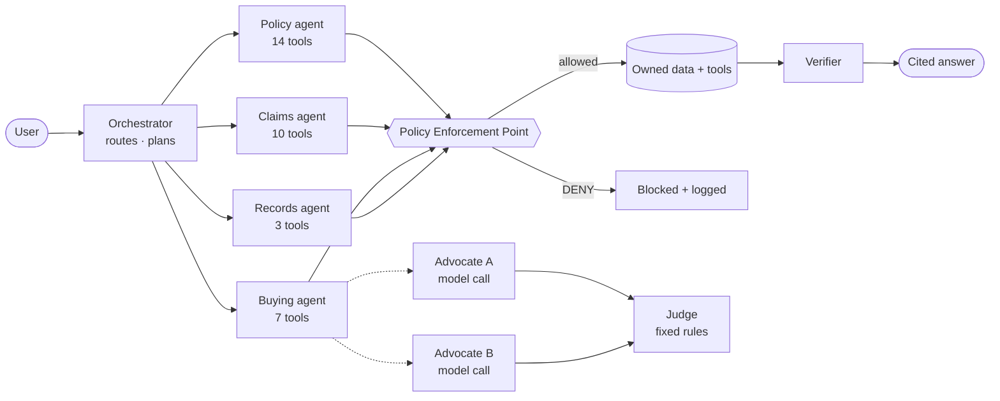

<div align="center">

# WeWise 微晓

### The customer-side AI agent for insurance: understand your cover, claim with confidence, prove every step

**保险问微晓，安心少烦恼** · *Ask WeWise about insurance, worry less.*

FinTechathon 2026 · International Track · Topic D, AI Insurance Assistant

**[▶ Live demo](https://wewise-demo.vercel.app)** · **[Verify a claim package](https://wewise-demo.vercel.app/verify)** · **[Smart contract on Etherscan](https://sepolia.etherscan.io/address/0x32d87197Ebccb47e8B5D46677Df5db4672A515D7)** · **[Agent architecture](docs/AGENT_ARCHITECTURE.md)** · **[Repository](https://github.com/pennythewise/WeWise)**

</div>

---

## For judges: where each criterion is met

| Criterion | What to look at | Evidence |
|---|---|---|
| **Task completion (40%)** | Seven end-to-end scenarios S1–S7 in the [live demo](https://wewise-demo.vercel.app): policy upload and Q&A, comparison, a claim abroad, a full claim, handoff | [Features](#features) · [Try it in 2 minutes](#try-it-in-2-minutes) · 371 backend tests |
| **Security & compliance (30%)** | Role-scoped agents, a policy gate the model cannot override, no money tools, cited answers, PII masking, on-chain audit | [Security](#security--compliance) · 180 attack cases, 0 failures |
| **Innovation & interaction (30%)** | AI advocates + rule-based judge, live agent Inspector, AR evidence capture, emergency call flow, tamper-proof claim packages anyone can verify | [Agents](#agents) · [Blockchain](#blockchain-proofs) |
| **Challenge bonus (on-chain)** | `ProofRegistry` live on Ethereum Sepolia, FISCO BCOS-compatible bytecode, public `/verify` | [Contract](https://sepolia.etherscan.io/address/0x32d87197Ebccb47e8B5D46677Df5db4672A515D7) · [first anchored package](https://sepolia.etherscan.io/tx/0x1c29b59b4e4f15cec76401c7cab7ef8652de012144557e5e96edaabe8e326930) |
| **Source code deliverable** | README, repository link, deployment instructions, test cases | [Deploy](#deploy) · [Tests](#tests) · CI on every push |

---

## Problem

- **Policies are unreadable.** People hold several policies from different insurers and cannot say what is covered, what is excluded, or where their cover overlaps.
- **Claims fail on preparation.** Missing documents, missed deadlines and inconsistent dates cause back-and-forth with the insurer, worst of all when someone is ill or abroad.
- **AI in finance is hard to trust.** A chatbot that guesses coverage, can be talked into moving money, or leaves no evidence of what it did is not safe to put in front of policyholders.

## Solution

WeWise is a **neutral, customer-side AI agent** that stays with the policyholder from reading a policy to filing a claim, and is **safe by construction**:

> **Understand** your cover with clause-cited answers → **Plan** what to buy or claim → **Execute safely** under a policy gate → **Prove** every step on-chain.

It never underwrites, never sells and never moves money. It prepares the customer and hands off to the insurer or a licensed agent, with consent.

---

## Features

| Area | What it does | Status |
|---|---|---|
| **Policy understanding** | PDF upload → per-page text and OCR → extracted limits, deductibles, waiting periods and exclusions the user confirms → plain-language answers with clause, page and quote | Live |
| **Portfolio and gaps** | One view across insurers; coverage gaps and overlaps; renewal and premium history | Live |
| **Comparison** | AI advocates argue for each product from source facts; a rule-based judge decides; cost-scenario arithmetic | Live (advocates use a model when configured) |
| **Claim preparation** | Waiting-period and exclusion pre-screen, personalised checklist, OCR consistency checks, reviewed PDF and ZIP claim package | Live |
| **Claim abroad** | Local emergency contacts, bilingual incident summary, cross-border claim kit | Live |
| **AR evidence capture** | Guided multi-photo capture with a 3D orientation guide, linked to the checklist | Live (prototype) |
| **Claim tracking** | Insurer state machine with a controllable clock and plain-language delay explanations | Simulated insurer |
| **Licensed-agent handoff** | Masked, consented brief for a matched agent | Simulated partner |
| **Proofs** | Claim packages, consents and audit trails anchored on-chain; public verification | Live on Sepolia |
| **Languages** | Chinese and English, switchable live | Live |

"Simulated" means a clearly labelled stand-in for an external party (insurer, partner) that has no public API.

---

## Try it in 2 minutes

Open the **[live demo](https://wewise-demo.vercel.app)**. On a wide screen the stage panel plays each scenario end to end, and the **Agent Inspector** shows every plan step, tool call and safety decision as it happens.

| | Scenario | What it shows |
|---|---|---|
| S1 | Upload and understand a policy | Extraction, user correction, a cited coverage answer; consent anchored on-chain |
| S2 | Compare with a judge | Buying agent, two AI advocates, a rule-based judge, licensed-agent handoff |
| S3 | Claim abroad (Thailand) | Coverage check, local contacts, Thai documents, claim kit anchored on-chain |
| S4 | Claim end to end | Pre-screen, documents, a fixed date error, confirmation, submission, insurer follow-up |
| S5 | Attack: hidden instruction | A document hides a payout-change instruction; it is flagged, blocked and sealed in the audit log |
| S6 | Attack: over-reach | Payout change, someone else's policy, fake insurer staff: all blocked |
| S7 | Fallback and handoff | Mixed-language and off-topic requests, refusal, human handoff |

Then open **[/verify](https://wewise-demo.vercel.app/verify)**: try the sample package, then "Tamper with one file" to watch verification fail.

> The S1–S7 scenarios are scripted so the demo is reproducible; their timing is paced like a live agent. Free-text chat uses the live backend when it is reachable.

---

## Agents

An **orchestrator** routes each request to one of four **role-scoped specialist agents**. Each owns a disjoint set of the 34 tools and sees only the identifiers its role needs. The orchestrator itself holds no tools.



| Component | Role | Model? |
|---|---|---|
| Orchestrator | Detects the goal, delegates to one specialist, builds a bounded plan (≤ 8 tools, ≤ 45 s) | No |
| Specialists | Policy, Claims, Buying, Records; least privilege enforced by `DENY:TOOL_ROLE` and `DENY:CONTEXT_SCOPE` | No |
| Policy explanation | Answers from retrieved clauses only, every sentence an exact cited extract | Yes, when a key is configured (Claude or OpenAI-compatible); retrieval-only otherwise |
| AI advocates | One separate model call per product; claims with unknown facts, invented numbers, guarantees or winner claims are dropped | Yes, when configured |
| Judge | Decides the comparison on fixed criteria; can return "no unique winner" | No, by design |
| Verifier | Checks citations, numbers and guarantee language before anything is shown | No |

Full design, diagrams and limits: **[docs/AGENT_ARCHITECTURE.md](docs/AGENT_ARCHITECTURE.md)**. Live map: `GET /api/agents`.

---

## Security & compliance

**Principles**

1. **The model has no authority.** Plans come from a fixed tool registry; model output cannot add a tool or a step.
2. **Numbers from code, words from the model.** Dates, limits, waiting periods and costs are computed deterministically.
3. **No money tools.** No transfer, payout, refund or premium payment exists anywhere in the code.
4. **Every claim is sourced**, or the assistant says it is not sure and offers a human.
5. **Least privilege between agents.** A manipulated buying turn cannot reach claim tools or claim data.
6. **Provable, not just logged.** Key actions are anchored on-chain as salted hashes.

**Risk tiers at the Policy Enforcement Point**

| Tier | Example | Gate |
|---|---|---|
| T0 | Product catalogue, emergency contacts | Scope check |
| T1 | Own policy or claim read | Authentication + ownership |
| T2 | Own-data write (draft, correction) | Argument validation + intent binding + audit |
| T3 | Data leaves the platform (export, handoff) | Single-use confirmation token bound to the exact snapshot |
| T4 | Payout account change, cancellation | **Never executed**: official-channel guidance only |

**Also enforced:** document text is quarantined as data and scanned for hidden instructions; PII is masked before any model or log; owner filtering on every query; per-user isolated demo workspaces; 24-hour expiry for temporary uploads; consent required before memory is used; request-size caps, same-origin writes and `no-store` API responses.

**Evaluated:** the attack corpus (hidden instructions, privilege escalation, cross-owner access, induced transfers, information elicitation) runs in CI: **180 attack cases and 167 task cases pass, 0 fail** (`python backend/eval/run.py`).

---

## Blockchain proofs

The customer and the insurer do not fully trust each other, and neither should have to trust WeWise's database. So WeWise anchors **fingerprints** of what matters on a shared ledger.

| Proof | Anchored when | On-chain |
|---|---|---|
| Claim package | The user confirms an export | Merkle root over every file in the ZIP |
| Consent | Any consent is granted or withdrawn | Hash of the consent record |
| Agent audit seal | The user seals a session | Merkle root over the audit log, including blocked actions |

- **Only hashes go on-chain:** a salted reference, a SHA-256 root, a kind and a time. No names, policy numbers, amounts or files. Deleting a case deletes its salt, so the entry can no longer be linked (right to erasure).
- **No money, no model access:** `ProofRegistry.sol` has no payable function and allowlisted writers only. The model has no chain tool, and the code refuses to run on mainnets.
- **Anyone can verify:** drop the ZIP on `/verify`. Changing one byte, adding or removing a file, or forging `proof.json` fails, and older versions are flagged.
- **Live:** [contract on Sepolia](https://sepolia.etherscan.io/address/0x32d87197Ebccb47e8B5D46677Df5db4672A515D7) · [first anchored claim package](https://sepolia.etherscan.io/tx/0x1c29b59b4e4f15cec76401c7cab7ef8652de012144557e5e96edaabe8e326930). The bytecode targets the `paris` EVM, for FISCO BCOS compatibility.

| `CHAIN_MODE` | Ledger |
|---|---|
| `local` (default) | Hash-linked dev ledger in SQLite, labelled as such |
| `evm` | `ProofRegistry` over JSON-RPC: Sepolia (live), FISCO BCOS web3 RPC, Hardhat or Anvil |
| `off` | No anchoring |

Design and roadmap (WeIdentity credentials, oracle attestations, FISCO node): [docs/onchainplan.md](docs/onchainplan.md).

---

## Architecture

```
Browser ── React 18 · Vite · TypeScript · Tailwind · i18next · React Three Fiber
   │        AgentClient: HttpAgentClient (SSE, live)  |  MockAgentClient (scripted S1–S7)
   │ /api
Vercel ── static frontend + api/gateway.mjs (host, method and body-size limits)
   │
Vercel Sandbox ── FastAPI (port 8017)
   ├─ Orchestrator → 4 specialists → Policy Enforcement Point → 34 tools
   ├─ Documents: PyMuPDF + RapidOCR → clauses → SQLite FTS5/BM25 (+ optional local E5 embeddings)
   ├─ Claims engine + insurer state machine (controllable clock)
   ├─ Optional LLM: Claude or any OpenAI-compatible model (retrieval-only without a key)
   └─ chain.py → ProofRegistry (Sepolia / FISCO BCOS / local ledger)
SQLite is the authoritative store; every query is owner-filtered.
```

---

## Deploy

**Requirements:** Node 24 with pnpm 11, Python 3.11.

### 1. Run locally

```bash
git clone https://github.com/pennythewise/WeWise.git && cd WeWise
cp .env.example .env                      # keep secrets here; never in src/ or VITE_*

# Backend
python3.11 -m venv .venv
.venv/bin/pip install -r backend/requirements.txt -r backend/requirements-chain.txt
WEWISE_RETRIEVAL_ONLY=1 WEWISE_SEED_DEMO=1 \
  .venv/bin/python -m uvicorn backend.app.main:app --port 8017 --env-file .env

# Frontend (second terminal)
pnpm --dir frontend install
pnpm --dir frontend dev                   # http://localhost:5173, proxies /api to :8017
```

The frontend also runs alone: without a backend, the S1–S7 scenarios and `/verify` sample mode still work.

### 2. Deploy to Vercel (frontend + gateway)

```bash
vercel login
vercel link                                # or create a new project
vercel env add PUBLIC_ORIGIN production --value https://<your-domain> --visibility config --no-sensitive
vercel deploy --prod
```

### 3. Provision the backend sandbox

The gateway forwards `/api` to a named Vercel Sandbox (`wewise-preview`). One script creates it, installs Python 3.11 and the dependencies, uploads only the `CHAIN_*` settings from `.env` (mode 0600, never printed) and starts the backend:

```bash
pnpm install                               # root package: @vercel/sandbox for the script below
vercel env pull .vercel/.env.oidc --yes --environment=development
export $(grep VERCEL_OIDC_TOKEN .vercel/.env.oidc | xargs)
node infra/scripts/provision-sandbox.mjs --chain-env .env
```

Check: `https://<your-domain>/api/health` and `/api/chain/status` (`"real_chain": true`).

### 4. Turn on real on-chain proofs (optional)

```bash
# In .env: CHAIN_RPC_URL (a Sepolia RPC such as Alchemy, or a FISCO BCOS web3 RPC) and CHAIN_SUBMITTER_KEY (a throwaway testnet wallet)
set -a; source <(grep -E '^CHAIN_(RPC_URL|SUBMITTER_KEY)=' .env); set +a
.venv/bin/python backend/contracts/deploy.py      # prints CHAIN_CONTRACT
# Then set in .env: CHAIN_MODE=evm, CHAIN_CONTRACT=…, CHAIN_EXPLORER_URL=https://sepolia.etherscan.io
```

Fund the wallet from a free Sepolia faucet. The deploy script refuses mainnets.

### 5. Turn on the LLM (optional)

Set `ANTHROPIC_API_KEY` (or `AI_PROVIDER`, `AI_BASE_URL`, `AI_MODEL`, `AI_API_KEY` for an OpenAI-compatible model) and remove `WEWISE_RETRIEVAL_ONLY=1`. Policy explanations and AI advocates then use the model, still behind the verifier and the policy gate.

<details>
<summary><b>All configuration variables</b></summary>

| Variable | Purpose |
|---|---|
| `WEWISE_RETRIEVAL_ONLY` | `1` disables all model calls (public preview mode) |
| `WEWISE_SEED_DEMO`, `WEWISE_DEMO_WORKSPACES` | Synthetic demo accounts; one isolated workspace per visitor |
| `WEWISE_ENV`, `WEWISE_ALLOWED_ORIGINS`, `COOKIE_SECURE` | Production origin and cookie hardening |
| `ANTHROPIC_API_KEY`, `ANTHROPIC_BASE_URL` | Claude |
| `AI_PROVIDER`, `AI_ENDPOINT`, `AI_BASE_URL`, `AI_MODEL`, `AI_API_KEY` | OpenAI-compatible model |
| `ADVOCATE_DAILY_LIMIT` | Daily cap on advocate model calls (default 200) |
| `WEWISE_EMBEDDING_DIR` | Optional local multilingual E5 embeddings |
| `TENCENT_MEMORY_URL`, `TDAI_GATEWAY_API_KEY` | Optional Tencent MemoryCore sidecar |
| `CHAIN_MODE`, `CHAIN_RPC_URL`, `CHAIN_CONTRACT`, `CHAIN_SUBMITTER_KEY`, `CHAIN_NETWORK`, `CHAIN_EXPLORER_URL` | On-chain proofs |

</details>

---

## Tests

```bash
.venv/bin/python -m pytest -q -c backend/pytest.ini   # 371 backend tests: functional, attack, chain, agents
.venv/bin/python backend/eval/run.py                  # golden tasks + attack corpus → backend/eval/report.md
node --test infra/tests/gateway.test.mjs              # gateway boundary tests
pnpm --dir frontend build                             # TypeScript check + production build
```

| Suite | What it proves |
|---|---|
| `test_attack_classes.py`, `test_guards.py` | Injection, escalation, cross-owner access and induced transfers are blocked |
| `test_specialists.py` | Each agent is confined to its tools and identifiers; advocate claims are checked; the judge stays rule-based |
| `test_chain.py` | Merkle proofs, tamper detection, privacy of on-chain data, consent and audit seals, the real contract on an in-process EVM |
| `test_workflows.py`, `test_scope_workflows.py` | Claim preparation, exports, comparison and buying flows end to end |
| `backend/eval/` | 167 golden tasks and 180 attack cases with a generated report |

CI ([`.github/workflows/verify.yml`](.github/workflows/verify.yml)) runs everything on every push and pull request.

---

## Repository layout

| Path | Contents |
|---|---|
| `frontend/src` | `app` router · `features` screens, cards, Inspector, `/verify` · `engine` agent clients, S1–S7 scenarios · `mock` synthetic data · `i18n` |
| `backend/app` | `agent_foundation` orchestrator, specialists, policy gate · `advocates` AI advocates · `intelligence` retrieval, LLM and verifier · `workflows` claims and buying · `chain` proofs and verification · `documents`, `document_analysis`, `lifecycle`, `memory`, `exports` |
| `backend/contracts` | `ProofRegistry.sol`, compiled ABI and bytecode, `deploy.py` |
| `backend/tests`, `backend/eval` | Test suite, golden-task and attack corpora, evaluation runner |
| `api/`, `infra/` | Vercel gateway, sandbox launcher and provisioning script |
| `docs/` | `AGENT_ARCHITECTURE.md` · `onchainplan.md` · `01_PRD.md` · `02_TECH_SPEC.md` · `03_FRONTEND_PRD.md` |

---

## Roadmap and business

| Next | Plugs into |
|---|---|
| Live insurer claim submission and status connectors | Insurer simulator interface, T3 confirmation path |
| FISCO BCOS consortium node and WeIdentity claim-readiness credentials | `CHAIN_MODE=evm`, `ProofRegistry` |
| Real-time voice emergency agent and on-device vision for evidence | Emergency flow, capture pipeline |
| Licensed-agent network with consented handoff | Buying agent handoff (T3) |

**Business model:** neutral and customer-side. Referral fees for consented licensed-agent introductions, qualified leads for partner insurers, and white-label B2B2C inside bank and insurer apps (better-prepared claims mean fewer back-and-forth requests for the insurer). **First users:** young professionals with several policies, frequent travellers, families, gig workers.

---

<sub>Synthetic data only. WeWise prepares and explains; it does not underwrite, approve claims or give licensed advice. Insurer names are illustrative labels with no affiliation or endorsement. The Sepolia deployment is a public testnet; the insurer and partner integrations are labelled simulations.</sub>
