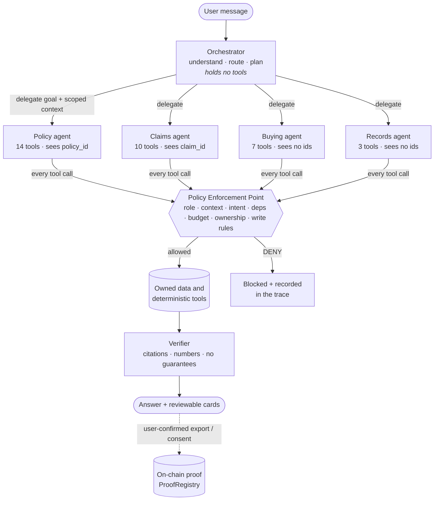
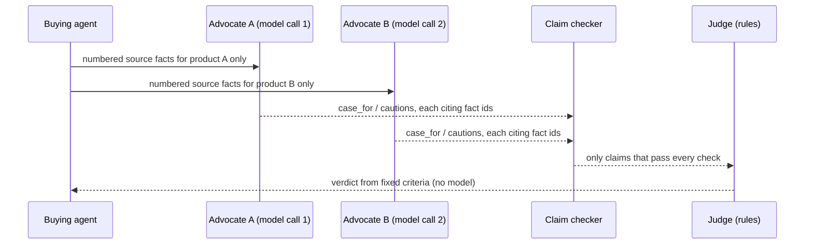

# WeWise Agent Architecture

WeWise uses an **orchestrator with four role-scoped specialist agents**, an independent policy gate, a verifier, and an **advocate-and-judge** pattern for product comparison. This page describes what the code does, including what is deterministic and what uses a model.

## 1. Overview

| Component | Code | Model? |
|---|---|---|
| Orchestrator | `backend/app/agent_foundation.py`: `detect_goal`, `agent_for`, `make_plan`, `stream_turn` | No: deterministic routing, with an optional advisory intent hint |
| Specialists | `AGENTS`, `_SPECIALIST_TOOLS` in `agent_foundation.py` | No: they run allowlisted tools |
| Policy Enforcement Point | `pep_validate` in `agent_foundation.py` | No |
| Verifier | `verify_model_output` in `backend/app/intelligence.py` | Checks model output; it is not a model itself |
| Policy explanation | `call_model` / `request_json` in `intelligence.py` | **Yes**, when a key is configured (Claude or an OpenAI-compatible model); otherwise retrieval-only |
| Advocates | `backend/app/advocates.py` | **Yes**, one call per product when configured; otherwise code-generated and labelled |
| Judge | `comparison` in `backend/app/insurance_features.py` | **No**: fixed rules |
| Human hand-off | `/buying/brief/*`, `/buying/callback` in `backend/app/workflows.py` | No; the partner connection is simulated |

## 2. Role-scoped specialists

The orchestrator routes each goal to exactly one specialist. `GOAL_AGENT` is derived from the tool registry, and an import-time assertion fails if a goal maps to two specialists.

| Specialist | Owns | Context it receives |
|---|---|---|
| **Policy agent** | policy read/search/explain, coverage matrix, portfolio, terms, clauses, summaries, documents, reports, renewal alerts, premium history (14) | `policy_id` |
| **Claims agent** | claim status, export preview, list, pre-screen, checklist, notifications, explanation, cross-border kit, incident types, emergency contacts (10) | `claim_id` |
| **Buying agent** | needs defaults and capture, catalogue, agent directory, sales-wording check, cost estimator, comparison (7) | none |
| **Records agent** | memory, document vault, audit history (3) | none |
| Orchestrator | nothing | n/a |

**Least privilege is enforced, not just described.** Every tool call passes `pep_validate` with the delegated role:

- `DENY:TOOL_ROLE`: the tool belongs to a different specialist. A buying turn manipulated into requesting `claim_status_get` is refused.
- `DENY:CONTEXT_SCOPE`: the step carries an identifier the specialist may not see, such as a `policy_id` handed to the buying agent.
- The other existing checks follow: intent binding, dependencies, the 8-step budget, required arguments, ownership, and the T2 write allowlist.

`make_plan` already strips out-of-scope identifiers when delegating, so these denials only fire if a plan was tampered with. The trace records the hand-off as a `delegate` event (`from`, `to`, `allowed_tools`, `context`), and each `execute` event names its agent. `GET /api/agents` publishes the whole map.

## 3. Advocate-and-judge comparison

- **Separate calls, separate context.** Each advocate is a separate model call that sees only its own product's facts. It is told to argue *for* that product, list honest cautions, and never declare a winner.
- **Every claim is checked** (`advocates.check_claims`) and dropped if it cites an unknown fact, contains a number not in the cited facts, makes a guarantee, declares a winner ("best", "cheapest", "最好"…), or contains an embedded instruction.
- **The judge is deterministic.** The existing rules in `insurance_features.comparison` decide. Price is not used as a default winner, and the result can be "no unique winner".
- **Fallbacks are labelled.** With no model configured, the code-generated advocates are used (`advocate_engine: rule_based`). An advocate whose claims all fail the checks falls back individually (`rule_based_fallback`).
- **Cost bound.** At most 3 advocates per comparison, plus a daily cap (`ADVOCATE_DAILY_LIMIT`, default 200 calls).
- **Endpoints.** `POST /api/buying/compare/debate`, and the buying agent's `product_compare` tool.

**Limits.** The claim check is a support check (fact ids, numbers, guarantees, verdicts, instructions), not proof of semantic entailment. An advocate may still paraphrase a fact weakly. That is why every shown claim carries its source fact for the user to compare, and why the judge does not use the advocates' prose.

## 4. Safety properties

| Property | Mechanism | Test |
|---|---|---|
| The model never holds authority | Plans come from a fixed registry; model output cannot add tools | `test_agent_foundation.py` |
| A specialist cannot use another's tools | `DENY:TOOL_ROLE` | `test_specialists.py::test_hijacked_buying_agent_cannot_reach_claim_tools` |
| A specialist sees only its identifiers | Scoped `make_plan`, `DENY:CONTEXT_SCOPE` | `test_specialists.py::test_specialists_cannot_receive_identifiers_outside_their_context` |
| Advocates cannot invent or decide | `check_claims`, rule-based judge | `test_specialists.py::test_advocate_claims_are_checked_against_source_facts` |
| No money movement | No transfer or payout tool exists; out-of-scope requests stay with the tool-less orchestrator | `test_attack_classes.py` |
| Actions are provable | Exports, consents and audit seals anchored on-chain | `test_chain.py` |

## 5. In the simulator

The S1–S7 simulations show the same structure with fixed, scripted output. Each turn opens with a `route_to_specialist` step naming the specialist and its tool count. S2 shows two `advocate_argue` calls (one claim dropped for an unsupported number) and a `judge_rules` step. Attack turns stay with the orchestrator, which has no tools to misuse.
