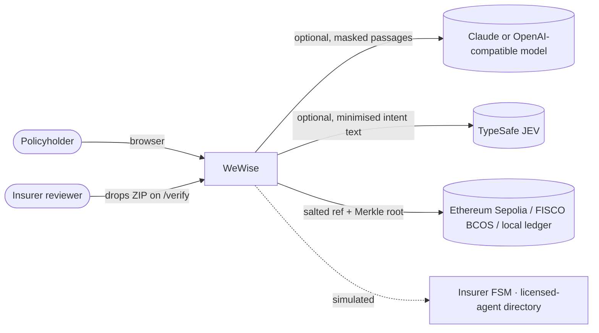
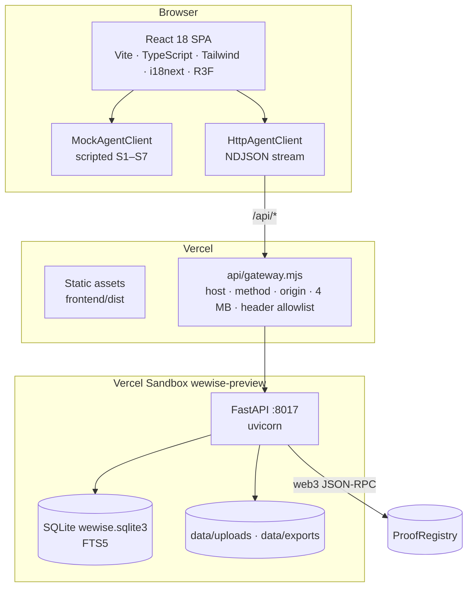
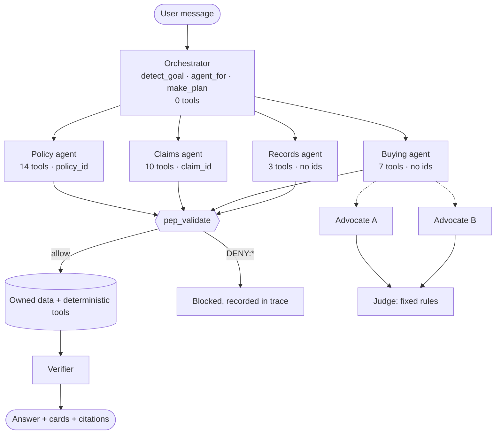
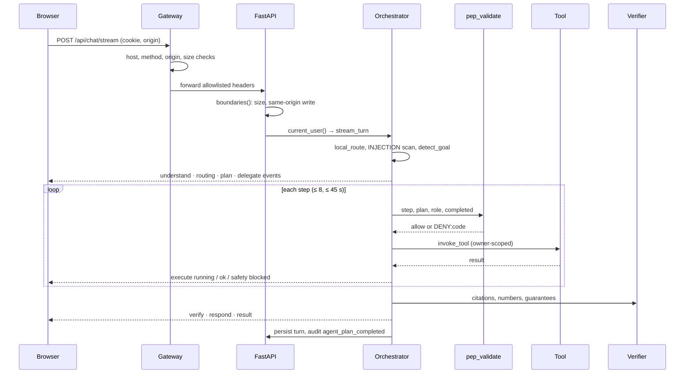
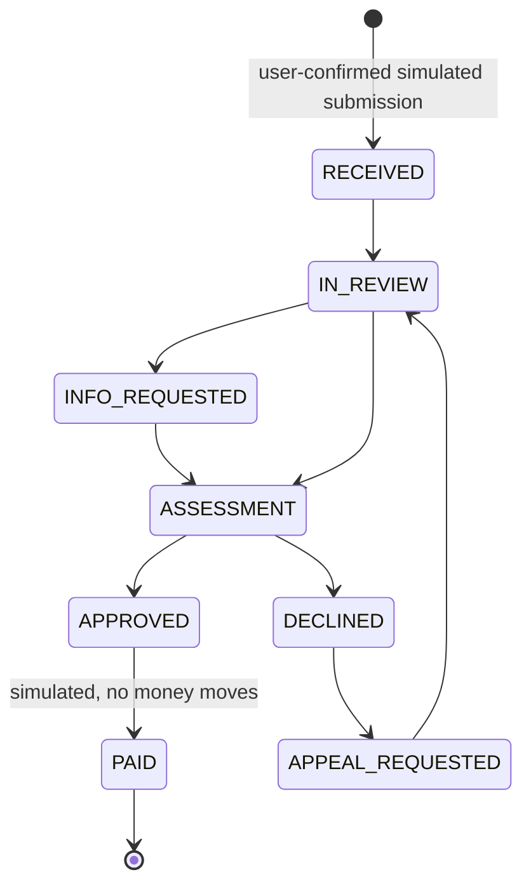

# WeWise 微晓: Technical Documentation

**Deliverable 01 · System architecture, core algorithms, security design**

| Field | Value |
|---|---|
| Product | WeWise 微晓, a customer-side AI agent for insurance (FinTechathon 2026, International Track, Topic D) |
| Document type | Solution architecture and design specification |
| Version | 1.0 |
| Baseline | Commit `1bee520` on `main`, 2026-10-20 |
| Backend version | `0.3.0` (`backend/app/main.py`) |
| Companion documents | [05 Security Self-Assessment](SECURITY_SELF_ASSESSMENT.md) · [06 Execution Evidence](EXECUTION_EVIDENCE.md) · [Agent architecture](AGENT_ARCHITECTURE.md) · [On-chain plan](onchainplan.md) |
| Data classification | Synthetic data only. No real customer, insurer or payment data is processed. |

---

## Contents

1. [Introduction](#1-introduction)
2. [Business context and scope](#2-business-context-and-scope)
3. [Requirements and traceability](#3-requirements-and-traceability)
4. [System architecture](#4-system-architecture)
5. [Data architecture](#5-data-architecture)
6. [Core algorithms](#6-core-algorithms)
7. [Security design](#7-security-design)
8. [Interface specification](#8-interface-specification)
9. [Blockchain design](#9-blockchain-design)
10. [Frontend architecture](#10-frontend-architecture)
11. [Deployment and operations](#11-deployment-and-operations)
12. [Quality assurance](#12-quality-assurance)
13. [Limitations and roadmap](#13-limitations-and-roadmap)
14. [Appendices](#14-appendices)

---

## 1. Introduction

### 1.1 Purpose

This document describes how WeWise is built: its architecture, its core algorithms and its security design. Every statement refers to code in this repository so a reviewer can check it. Where a capability is simulated or optional, the document says so.

### 1.2 Audience

| Reader | Sections to read first |
|---|---|
| Judges and reviewers | 2, 4, 6, 7, 9 |
| Engineers extending the system | 4, 5, 6, 8, 11 |
| Security and compliance reviewers | 7, then [05 Security Self-Assessment](SECURITY_SELF_ASSESSMENT.md) |

### 1.3 Design principles

| # | Principle | How the code enforces it |
|---|---|---|
| P1 | The model has no authority | Plans come from a fixed tool registry (`TOOLS` in `agent_foundation.py`). Model output cannot add a tool, a step or a permission. |
| P2 | Numbers from code, words from the model | Dates, waiting periods, limits and costs are computed with deterministic code (`Decimal` arithmetic, ISO dates). The verifier rejects any model number that is not in the cited source. |
| P3 | No money tools | No transfer, payout, refund or premium-payment function exists in the registry, the API or the smart contract. |
| P4 | Every claim is sourced | An answer cites owner-scoped clause extracts, or the system says it does not know and offers a human. |
| P5 | Least privilege between agents | Four specialists own disjoint tool sets and identifier scopes. The policy gate denies anything outside them. |
| P6 | Provable, not only logged | Claim packages, consents and audit batches are anchored on-chain as salted hashes and Merkle roots. |
| P7 | Honest boundaries | Simulated parties (insurer, licensed agent) are labelled in data, API responses and UI. |

### 1.4 Definitions

| Term | Meaning |
|---|---|
| Orchestrator | Deterministic coordinator that detects the goal, delegates to one specialist and builds a bounded plan. It holds no tools. |
| Specialist | One of four role-scoped agents (policy, claims, buying, records) that run allowlisted tools. |
| PEP | Policy Enforcement Point, the single function `pep_validate` every tool call passes. |
| Tier (T0–T4) | Risk class of an action, from public reads (T0) to never-executed actions (T4). |
| Verifier | Code that checks model output for citations, numbers, guarantees and injected instructions before display. |
| Advocate | A separate model call that argues for one product from numbered source facts. |
| Judge | Fixed rules that decide a comparison. It is not a model. |
| Anchor | Writing a salted reference and a SHA-256 Merkle root to a ledger. |
| Quarantine | Marking a document chunk as untrusted so it is never retrieved or sent to a model. |

---

## 2. Business context and scope

### 2.1 Problem

| Pain point | Effect on the policyholder |
|---|---|
| Policies are long and technical | People cannot tell what is covered, excluded or duplicated across insurers. |
| Claims fail on preparation | Missing documents, missed notification windows and inconsistent dates cause rework, worst when someone is ill or abroad. |
| AI in finance is hard to trust | A chatbot that guesses cover, can be talked into moving money or leaves no evidence is unsafe for consumers. |

### 2.2 Solution summary

WeWise is a **neutral, customer-side** assistant. It follows one loop: **Understand** a policy with cited answers, **Plan** what to buy or claim, **Execute safely** under a policy gate, **Prove** each step on-chain. It never underwrites, sells, approves claims or moves money. It prepares the customer and hands off to the insurer or a licensed professional, with consent.

### 2.3 Regulatory positioning

| Activity | WeWise does it? | Why |
|---|---|---|
| Explain policy wording with citations | Yes | Information service on the user's own documents |
| Compare products from published wording | Yes, with a rule-based judge and "no unique winner" outcome | Educational comparison; price is never the default winner |
| Recommend or sell a specific product | **No** | Sales and advice are handed to a licensed professional (simulated directory) |
| Decide eligibility or approve a claim | **No** | Every answer carries an insurer-review disclaimer (`DISCLAIMER` in `intelligence.py`) |
| Submit a claim to an insurer | **No** (download only) | Exports state `submitted: false`, `recipient: "User download only"` |
| Move money or change payout details | **No** (T4, does not exist) | See section 7.3 |

### 2.4 Capability boundary

The `/api/capabilities` endpoint publishes this boundary at runtime.

| Status | Capabilities |
|---|---|
| **Real** | Accounts and sessions; document upload, per-page extraction and CPU OCR; critical-fact review; owner-scoped cited retrieval; coverage gaps and overlaps; portfolio and document vault; 24-hour temporary uploads; claim pre-screen, checklist, consistency checks and package export; approved memory; persisted conversations and validated plans; streamed execution trace; rule-based comparison and cost arithmetic; renewal and premium history; on-chain proofs (local ledger, or Sepolia via `CHAIN_MODE=evm`) |
| **Conditional** | Live model (Claude or OpenAI-compatible) when a key is set; local E5 embeddings when installed; TypeSafe JEV advisory routing when a key is set; voice when the browser allows |
| **Simulated** | Insurer receipt and processing timeline (state machine); licensed-agent directory and callback |
| **Not connected** | Insurer submission API, insurer status feed, WeBank SSO, live telephone transfer |

---

## 3. Requirements and traceability

### 3.1 Functional requirements

| ID | Requirement | Implementation | Verified by |
|---|---|---|---|
| FR-01 | Upload a policy (PDF, JPG, PNG, TXT) and extract text per page with OCR fallback | `documents.extract_pages`, `upload_document` | `test_document_foundation.py`, `test_core.py` |
| FR-02 | User reviews and confirms critical facts before personal conclusions | `PATCH /api/policies/{id}`, `critical_fact_gate` in `_chat_answer` | `test_core.py::test_unconfirmed_policy_blocks_personalized_guidance` |
| FR-03 | Answer policy questions with clause, page and quote | `intelligence.retrieve`, `extractive_answer`, `verify_model_output` | `test_core.py`, `test_guards.py` |
| FR-04 | Portfolio view with coverage gaps and overlaps | `documents.portfolio`, `document_analysis.coverage_matrix` | `test_scope_workflows.py` |
| FR-05 | Compare products with advocates and a rule-based judge | `workflows.compare_products`, `advocates.debate`, `insurance_features.comparison` | `test_specialists.py` |
| FR-06 | Cost scenario arithmetic from user-reviewed terms | `insurance_features.estimate_cost` | `test_workflows.py` |
| FR-07 | Claim pre-screen (waiting period, exclusions) and personalised checklist | `workflows._prescreen`, `_checklist` | `test_workflows.py`, `test_release_workflow_edges.py` |
| FR-08 | Detect inconsistencies across reviewed documents | `workflows._validation` | `test_workflows.py` |
| FR-09 | Export a reviewed claim package (PDF + ZIP) only after explicit confirmation | `preview_claim`, `export_claim`, single-use tokens | `test_workflows.py`, `test_chain.py` |
| FR-10 | Cross-border kit with verified local contacts | `crossborder_kit`, `emergency` | `test_workflows.py::test_guest_contacts_remain_available_without_auth` |
| FR-11 | Track a claim through a labelled insurer simulator | `claims_tracker.py` FSM | `test_release_workflow_edges.py` |
| FR-12 | Consented, masked brief for a licensed agent | `/buying/brief/preview`, `/buying/brief/export` | `test_scope_workflows.py` |
| FR-13 | Approved, editable, deletable memory | `memory.py` | `test_memory.py` |
| FR-14 | Anchor packages, consents and audit seals; public verification | `chain.py`, `ProofRegistry.sol` | `test_chain.py` |
| FR-15 | Stream each plan step, tool call and safety decision | `stream_turn`, `/api/chat/stream`, `/api/traces/{id}` | `test_agent_foundation.py` |
| FR-16 | Chinese and English, switchable live | `frontend/src/i18n`, `locale` argument end to end | Frontend build |

### 3.2 Non-functional requirements

| ID | Quality | Target | Mechanism |
|---|---|---|---|
| NFR-01 | Bounded agency | ≤ 8 tool calls and ≤ 45 s per turn | `Plan.steps max_length=8`; time check in `stream_turn`; `asyncio.wait_for` per tool |
| NFR-02 | Isolation | Every owned row filtered by `user_id` | `WHERE ... AND user_id=?` on every query; PEP ownership check |
| NFR-03 | Request limits | 16 MB backend, 4 MB gateway, 15 MB per file, 100 pages, 12 OCR pages, 150 MB per user | `main.boundaries`, `sandbox-gateway.mjs`, `documents.py` |
| NFR-04 | Model cost bound | ≤ 3 concurrent model calls; ≤ 3 advocates per comparison; 200 advocate calls per day | `MODEL_SEMAPHORE`, `MAX_PRODUCTS`, `ADVOCATE_DAILY_LIMIT` |
| NFR-05 | Graceful degradation | Every optional dependency has a labelled fallback | Section 11.4 |
| NFR-06 | Reproducibility | Deterministic routing, plans and judge; model temperature 0 | `detect_goal`, `make_plan`, `comparison`, `request_json` |
| NFR-07 | Concurrency safety | No double-spend of a confirmation; no lost conversation update | `BEGIN IMMEDIATE`; optimistic `revision` on conversations, policies and claims |
| NFR-08 | Accessibility of evidence | Anyone can verify a package without an account | `POST /api/verify` is public, read-only, rate-limited |

---

## 4. System architecture

### 4.1 Context view (C4 level 1)



External systems receive only what the table below lists.

| External system | Receives | Never receives | Switch |
|---|---|---|---|
| Model provider | Masked question and masked clause passages | Account ids, policy numbers, names, full documents, tools | `WEWISE_RETRIEVAL_ONLY=1` blocks all calls |
| TypeSafe JEV | Minimised question (emails, numbers, secrets redacted, ≤ 800 chars) | Policy text, ids | Off unless `TYPESAFE_API_KEY` is set |
| Ledger | 32-byte salted reference, 32-byte root, kind, timestamp | Names, policy numbers, amounts, files, contact details | `CHAIN_MODE=off` |

### 4.2 Container view (C4 level 2)



| Container | Technology | Responsibility |
|---|---|---|
| SPA | React 18.3, Vite, TypeScript, Tailwind, Zustand, i18next, React Three Fiber, Recharts | Phone-frame app, Agent Inspector, `/verify`, scripted scenarios |
| Gateway | Vercel Function (Node 24), `@vercel/sandbox` | Validates host, method, origin and size; forwards `/api/*` to the sandbox with an allowlist of headers; wakes a stopped sandbox |
| Backend | Python 3.11, FastAPI, Pydantic v2, uvicorn | All business logic, policy gate, persistence, exports, chain adapter |
| Store | SQLite (`foreign_keys=ON`, FTS5, 20 s busy timeout) | Authoritative data; one writer process |
| Ledger | `ProofRegistry.sol` on Sepolia, or a hash-linked SQLite ledger | Tamper evidence |

### 4.3 Component view (backend, C4 level 3)

| Module | Lines | Responsibility | Key symbols |
|---|---:|---|---|
| `main.py` | 125 | App factory, transport boundaries, security headers, health and capabilities, SPA hosting | `create_app`, `boundaries` |
| `core.py` | 200 | Identity, sessions, password hashing, DB access, audit | `current_user`, `hash_password`, `audit`, `get_db` |
| `agent_foundation.py` | 616 | Tool registry, specialists, PEP, plan builder, streamed executor, conversations, traces | `TOOLS`, `AGENTS`, `pep_validate`, `make_plan`, `stream_turn` |
| `intelligence.py` | 528 | Retrieval, PII masking, model transport, verifier, extractive fallback, scope router | `retrieve`, `mask_pii`, `verify_model_output`, `local_route`, `OUT_OF_SCOPE` |
| `semantic_retrieval.py` | 139 | Optional local multilingual E5 vectors and reciprocal-rank fusion | `hybrid_order` |
| `documents.py` | 571 | Upload, type sniffing, extraction, OCR, chunking, quarantine, policies, portfolio | `extract_pages`, `index_document`, `INJECTION` |
| `document_analysis.py` | 376 | Term extraction, clause listing, summaries, coverage matrix, report review | `coverage_matrix`, `analyze_policy` |
| `workflows.py` | 1178 | Claims, checklists, validation, confirmation tokens, exports, buying, renewals | `_prescreen`, `_checklist`, `_validation`, `_make_token`, `export_claim` |
| `claims_tracker.py` | 186 | Insurer state machine, controllable clock, notifications | `NEXT`, `transition` |
| `insurance_features.py` | 184 | Requirements library, cost arithmetic, rule-based judge, agent matching | `estimate_cost`, `comparison`, `match_agents` |
| `advocates.py` | 112 | Advocate model calls and claim checks | `facts_for`, `check_claims`, `debate` |
| `memory.py` | 267 | Approved memory ledger, optional Tencent MemoryCore mirror | `check_memory`, `approved_context` |
| `lifecycle.py` | 221 | Temporary uploads (24 h), vault, consents | `consent`, `purge_expired` |
| `chain.py` | 369 | Merkle maths, ledgers, anchoring, verification API | `merkle_root`, `LocalLedger`, `EvmLedger`, `verify_archive` |
| `exports.py` | 101 | PDF (ReportLab), manifest and ZIP assembly | `pdf_bytes`, `zip_bytes` |
| `jev_adapter.py` | 92 | Advisory intent classification with strict validation | `suggest`, `validated_choice` |

### 4.4 Agent topology



The full tool-to-agent map is in section 7.2 and in [05 Security Self-Assessment, section 3](SECURITY_SELF_ASSESSMENT.md#3-permission-tier-implementation). It is published live at `GET /api/agents`.

### 4.5 Request lifecycle (one chat turn)



---

## 5. Data architecture

### 5.1 Logical data model

All tables live in one SQLite database (`data/wewise.sqlite3`). Every table holding personal data carries `user_id`.

| Domain | Tables | Notes |
|---|---|---|
| Identity | `users`, `sessions` | Passwords PBKDF2-SHA256 (310 000 rounds); sessions store only the SHA-256 of the token |
| Documents | `documents`, `document_chunks`, `chunks_fts` (FTS5), `semantic_embeddings`, `document_reviews`, `temporary_documents` | Chunks carry `quarantined`; FTS and vectors are owner-scoped |
| Policies | `policies`, `policy_documents`, `policy_premium_history` | `confirmed` flag and `revision` counter gate personal conclusions |
| Claims | `claims`, `claim_evidence`, `claim_updates`, `claim_simulator_state`, `claim_simulations`, `claim_simulation_details`, `claim_notifications` | Simulator rows are flagged `is_simulated` |
| Actions | `workflow_actions`, `confirmations`, `workflow_exports` | Tokens stored as SHA-256 hashes; single-use tombstones |
| Agent | `conversations`, `agent_turns` | Plan, events and result JSON per turn |
| Buying | `buying_needs`, `buying_callbacks` | Callbacks are simulated |
| Memory and consent | `memories`, `preferences`, `memory_sync`, `processing_consents` | Memory is off by default |
| Audit | `audit_log` | Operational metadata only, never document text, keys or contact PII |
| Chain | `chain_salts`, `chain_proofs`, `chain_blocks` | Salts are erasable; `chain_blocks` is the local hash-linked ledger |

### 5.2 Data classification

| Class | Examples | Where it may go |
|---|---|---|
| C1 Restricted | Uploaded files, claim evidence, medical and financial reports | Owner only; included in an export only after T3 confirmation |
| C2 Personal | Name, email, policy number, insured name, incident facts | Owner only; masked before any model call; never on-chain; never in audit details |
| C3 Derived | Citations, coverage matrix, checklists | Owner only |
| C4 Operational | Audit actions, trace stages, tool names, latencies | Owner's audit view; hashed into audit seals |
| C5 Public | Salted references, Merkle roots, product catalogue, emergency contacts | Ledger, public API |

### 5.3 Data lifecycle

| Stage | Rule | Code |
|---|---|---|
| Collect | Only the formats PDF, JPEG, PNG, UTF-8 TXT, with magic-byte checks | `upload_document` |
| Temporary | Not indexed; access ends after 24 h; purged on access, cleanup and startup | `lifecycle.TTL`, `purge_expired` |
| Save | Explicit; consent record `save_document_until_deleted` anchored on-chain | `lifecycle.consent` |
| Use | Owner-scoped reads; quarantined chunks excluded from retrieval and models | `retrieve`, `hybrid_order` |
| Change | Any change to a policy or its documents bumps `revision`, clears `confirmed` and revokes derived exports and pending tokens | `_remove_derived_exports` |
| Delete | Removes rows, FTS entries, vectors and the original file; deleting a case deletes its chain salt so its on-chain root can no longer be linked | `delete_document`, `delete_policy`, `delete_claim` → `chain.forget` |
| Out of scope | Hosting snapshots and files already downloaded by the user | Stated in every deletion response |

---

## 6. Core algorithms

### 6.1 Goal detection and routing

Routing is deterministic and safety-first. An optional advisory classifier can only refine a generic `policy_question`.

```text
function route(message):
    if contains_emergency_terms(message):            return "emergency"       # 紧急, 救命, bleeding, 自杀 …
    if contains_blocked_keywords(message)
       or OUT_OF_SCOPE.matches(message):              return "outside_scope"   # transfers, payout changes, other people's data, admin claims, crypto/stock tips
    if contains_buying_terms(message):                return "buying"
    return "policy_question"

function detect_goal(message, base_route):
    if INJECTION.matches(message):                    return "outside_scope"
    if base_route in {"outside_scope","emergency"}:   return base_route
    for (pattern, goal) in 14 ordered goal patterns:  # sales_check, crossborder, claim_checklist, … incidents
        if pattern.matches(message):                  return goal
    if base_route == "buying":                        return "buying"
    if gap/overlap terms:                             return "coverage_analysis"
    if claim package terms:                           return "claim_preview"
    if claim status terms:                            return "claim_status"
    return "policy_question"

advisory (JEV) may replace the goal only when:
    goal == "policy_question" and not protected and not resumed
    and suggestion ∈ {policy_question, coverage_analysis, claim_status, buying, emergency, outside_scope}
    and validated_choice(): choice probability ≥ 0.75, confidence ≥ 0.75, probabilities sum to 1 ± 0.02
```

Protected messages (emergency, out of scope, injection) never reach the advisory classifier.

### 6.2 Plan construction and bounded execution

```text
make_plan(goal, policy_id, claim_id, message, locale):
    agent  ← GOAL_AGENT[goal]  or "orchestrator"            # one goal → one specialist (import-time assertion)
    scope  ← AGENTS[agent].context                           # {policy_id} | {claim_id} | ∅
    args   ← ToolArgs(only identifiers in scope, query=message, locale)
    tools  ← FIXED_TOOL_LIST[goal]                           # e.g. policy_question → [policy_get, policy_search_clauses, policy_explain]
    steps  ← chain tools as s1 → s2 → … with depends_on
    missing← required identifier absent → ask the user (clarification card), run nothing
    return Plan(source="deterministic_validated", ≤ 8 steps)

stream_turn:
    lock conversation (BEGIN IMMEDIATE, in_flight_until = now + 50 s, expected_revision check)
    emit understand, routing, plan, delegate
    for step in plan.steps:
        if elapsed > 45 s: stop (turn_time_budget)
        pep_validate(step)                                   # section 6.3
        result ← await wait_for(invoke_tool(step), remaining budget)
        on DENY:*  → emit safety/blocked and stop
        on error   → emit execute/failed, keep completed reads, stop
    compose answer from results (fixed templates per goal)
    emit verify, respond; persist turn with optimistic revision; audit
```

### 6.3 Policy Enforcement Point

`pep_validate(db, user, plan, step, completed, role)` runs these checks in order. The first failure raises and stops the turn.

| # | Check | Deny code | HTTP |
|---:|---|---|---:|
| 1 | Tool exists and belongs to the delegated specialist | `DENY:TOOL_ROLE` | 403 |
| 2 | Step carries no identifier outside the specialist's context | `DENY:CONTEXT_SCOPE` | 403 |
| 3 | Step is identical to the step in the plan, and the plan goal is one the tool serves | `DENY:UNBOUND_INTENT` | 403 |
| 4 | All `depends_on` steps completed | `DENY:DEPENDENCIES` | 409 |
| 5 | Plan has ≤ 8 steps with unique ids | `DENY:PLAN_BUDGET` | 422 |
| 6 | Required arguments present | `DENY:MISSING_ARGUMENT:<field>` | 422 |
| 7 | Every `policy_id`, `claim_id`, `document_id` is owned by the caller | `Resource not found.` | 404 |
| 8 | A T2 tool runs only in its bound goal (`claim_export_preview`↔`claim_preview`, `product_compare`↔`buying`) | `DENY:UNBOUND_WRITE` | 403 |

The direct adapter `POST /api/agent/tools/invoke` adds a check before these: only T0 and T1 tools are callable (`DENY:READ_ONLY_TOOL_ADAPTER`), and out-of-scope identifiers are dropped and recorded in the audit entry.

### 6.4 Document ingestion

```text
upload(file):
    read ≤ 15 MB + 1 byte; reject empty or oversized (413)
    media ← magic bytes: %PDF- → pdf | \x89PNG → png | \xFF\xD8\xFF → jpeg | declared text/plain or .txt → text
            otherwise 415 ("File content must match its type")
    quota: user's stored bytes + new ≤ 150 MB
    pages ← extract_pages(raw):
        text: UTF-8 only, no NUL, ≤ 1.5 M chars
        pdf/image via PyMuPDF: reject encrypted; 1 ≤ pages ≤ 100
        per page: text ← get_text; spans with bounding boxes (pdf_points)
            if len(text) < 30 and OCR pages used < 12:
                render at ≤ 2400 px long side → RapidOCR (CPU, bundled models, no download)
                spans with pixel boxes and confidence
            elif quota reached or OCR fails: method = manual_required, warning, no invented text
    chunks ← split on blank lines / numbered clause headings; ≤ 700 chars, 100-char overlap for long paragraphs
    for chunk: quarantined ← INJECTION.matches(chunk)
    insert chunks; insert non-quarantined chunks into FTS5
    field_candidates(): propose insurer, policy number, insured name, dates with source page and quote
    policy.confirmed ← 0 until the user confirms the critical fields
```

`INJECTION` matches phrasings such as "ignore previous instructions", "system prompt", "developer message", "reveal secrets/API key/password", chat-template tokens (`<|im_start|`, `<|system`), and Chinese equivalents (忽略…指令/规则, 泄露…密钥/密码).

### 6.5 Hybrid retrieval

For a policy `p` owned by user `u` and query `q`:

1. **Term expansion.** `terms_for(q)` extracts Latin words (≥ 3 letters), numbers and CJK runs (≤ 8 characters kept whole, longer runs split into bigrams), adds domain synonyms (for example *outpatient* → 门诊, 医疗费用), removes stop words, and keeps at most 70 terms.
2. **Candidate set.** Non-quarantined chunks of documents linked to `p` with `user_id = u`.
3. **Lexical score.** For each chunk `d` of length `|d|` and each matched term `t` with term count `c`:

   `idf(t) = ln(1 + (N − n_t + 0.5) / (n_t + 0.5))`
   `score(d) = Σ_t idf(t) · c · 2.2 / (c + 1.2 · (0.25 + 0.75 · |d| / 500))`

   This is BM25 with `k1 = 1.2` and `b = 0.75`, average length fixed at 500.
4. **FTS5 fusion.** If SQLite FTS5 returns the chunk at rank `r` (`bm25(chunks_fts)`), add `1 / (1 + r)`.
5. **Intent boosts.** For medical queries, chunks naming medical records or original expense receipts are ×1.4; death-certificate sections ×0.15; a medical *documents-required* section ×6 when the query asks for documents.
6. **Optional semantic fusion.** When local E5 (`multilingual-e5-small`, 384 dimensions, ONNX on CPU) is installed, vectors are cached per chunk hash and fused by reciprocal rank: `RRF(d) = Σ_lists 1 / (60 + rank + 1)`.
7. **Focus.** For a medical-documents question, only matching document-list sections are kept, so the answer is not padded with unrelated clauses.
8. **Context budget.** Top 5 chunks within 9 500 characters, each returned with `id` (C1…), `document_id`, `page`, `quote`.

### 6.6 Grounded answer and verifier

The answer path is extractive by default. A model is used only when configured, and its output must pass every check below. Otherwise the extractive answer is shown with the reason in the trace.

| # | Verifier check (`verify_model_output`) | Rejection code |
|---:|---|---|
| 1 | Valid JSON with `answer` (10–4 500 chars) and a non-empty `citation_ids` list | `invalid_response_schema` |
| 2 | Every cited id is a retrieved passage | `unknown_citation` |
| 3 | Every inline `[Cn]` is declared | `undeclared_inline_citation` |
| 4 | Every number in the answer appears in the cited passages | `unsupported_numeric_claim` |
| 5 | No guarantee language ("guaranteed payout", 一定会赔, 必赔 …) and no injected instruction | `unsupported_authority_or_instruction` |
| 6 | Every declared citation appears inline | `missing_inline_citation` |
| 7 | 1–12 structured assertions are supplied | `structured_source_assertions_required` |
| 8 | Each assertion is valid and cites known, declared passages | `invalid_assertion_schema`, `unknown_assertion_citation` |
| 9 | Each assertion is an exact contiguous extract of its cited passage | `assertion_not_source_extract`, `assertion_quote_mismatch` |
| 10 | The answer text equals the concatenated assertions (whitespace-normalised) | `undeclared_factual_text` |

Before the response is returned, the code re-reads the policy and each cited chunk. If the policy revision changed, the policy was unconfirmed, or a quote no longer matches the stored chunk, the request fails with 409.

Before any model call, `mask_pii` replaces the user's email and display name, the insured name and policy number, any email address, mainland mobile numbers, 18-character resident ID numbers and 16–19 digit account numbers with placeholders.

### 6.7 Advocate-and-judge comparison

```text
facts_for(product) → [F1 benefit, F2 wording version, F3 insurer, F4.. matched priorities, F.. limitations]

argue(product):                       # one model call per product, ≤ 3 products, daily cap 200
    prompt: argue FOR this product only, from numbered facts, no winner, no guarantees, cautions required
    output: {case_for: [{text, fact_ids}], cautions: [...]}
    check_claims(each):
        8 ≤ len(text) ≤ 320, cites ≥ 1 known fact     else unknown_or_missing_fact
        numbers ⊆ numbers in cited facts               else unsupported_number
        no guarantee, no INJECTION                     else guarantee_or_instruction
        no WINNER words (best, cheapest, 最好, 首选 …)   else advocate_declared_winner
    keep ≤ 4 claims; if none survive → rule_based_fallback for that advocate

judge = comparison(products, needs):  # deterministic
    criteria: coverage_fit, exclusions, deductible, waiting_period, renewal, affordability, claim_friction, scenario_out_of_pocket
    unknown criteria are shown as "unknown", never guessed
    score = matched feature tags; tied top → "no unique best product"
    price_used = false; claims_probability_used = false
```

### 6.8 Claim pre-screen, checklist and consistency checks

**Waiting period.** The waiting period is used only if its number is source-verified: a user-reviewed term whose cited quote contains the same number, bound to an owned source document.

`eligible_from = policy.start_date + waiting_days` (calendar days). Status is `pass` if `incident_date ≥ eligible_from`, `possible_exclusion` otherwise, and `unresolved` when no verified number exists. A zero-day period is never assumed.

**Checklist.** `requirements(family, benefit, incident)` gives required and conditional categories (identity, travel proof, medical record, original expense, claim form; discharge record only for inpatient; incident evidence only for police or third-party events). An entry is satisfied only by a user-confirmed document in that category. The policy entry is satisfied by the confirmed policy's own files at the current revision.

**Consistency checks** (`_validation`) on user-confirmed fields:

| Code | Rule |
|---|---|
| `PATIENT_NAME_MISMATCH` | Patient or insured name ≠ confirmed insured name (whitespace and case-insensitive) |
| `INVALID_DATE` | Date field not ISO-8601 |
| `DISCHARGE_BEFORE_ADMISSION` | `discharge_date < admission_date` |
| `TREATMENT_BEFORE_INCIDENT` | `treatment_date < incident.date` |
| `INVALID_AMOUNT` | Non-numeric, or outside 0–100 000 000 |
| `EXPENSE_AMOUNT_MISMATCH` | Same currency and `abs(amount − incident.expenses) > 0.01` |

A **prepared** package requires a confirmed policy at the current revision, confirmed case facts, no missing evidence and no inconsistencies. Otherwise only a labelled **draft** can be exported.

### 6.9 Cost scenario arithmetic

Computed with `Decimal` and `ROUND_HALF_UP` only when `limit`, `deductible` and `coinsurance_percent` are present, the terms are user-confirmed with a source note, and the scenario is not marked ineligible:

```text
eligible = max(0, bill − deductible)
insurer_pays = min(limit, round(eligible × (1 − coinsurance_percent / 100), 2))
you_pay = bill − insurer_pays
```

Otherwise the result is `known: false` with the missing fields. Unknown is never shown as zero. No currency conversion is performed.

### 6.10 Confirmation tokens (T3 actions)

```text
preview(entity, mode, action, recipient):
    snapshot ← {claim revision, policy revision and fields, policy files, incident, evidence with sha256,
                checklist, missing, prescreen, mode, action, recipient, not_submitted: true}
    token ← random 32 bytes (url-safe); store SHA-256(token), entity, action, controls, SHA-256(canonical snapshot)
    expires_at ← now + 600 s; expired tokens for the user are deleted
    return token, snapshot (for the user to review)

export(token, confirmed=true):
    BEGIN IMMEDIATE                          # serialises concurrent attempts
    row ← lookup by SHA-256(token) and user_id; reject if missing, used, expired or other action
    reject if entity differs
    current ← rebuild snapshot; reject if SHA-256(current) ≠ stored hash   # anything changed → review again
    build PDF + manifest + originals; anchor Merkle root (section 6.11)
    mark token used (tombstone, payload cleared)
```

The same pattern protects the simulated insurer submission and the licensed-agent brief export.

### 6.11 Merkle proofs and package verification

**Tree.** Leaves are SHA-256 file digests in archive order. `leaf = H(0x00 ‖ digest)`, `node = H(0x01 ‖ left ‖ right)`. An odd node is promoted unchanged. The 0x00/0x01 prefixes separate leaves from nodes, which prevents second-preimage attacks that reinterpret an inner node as a leaf.

**Reference.** `ref = SHA-256(salt ‖ "|" ‖ kind ‖ "|" ‖ entity_id)` with a 32-byte random salt per (kind, entity). Deleting the salt makes the on-chain entry unlinkable.

**Package.** `01-reviewed-summary.pdf`, `02-manifest.json`, `originals/NN-*`, `README.txt`, and `proof.json` with `schema: wewise.proof/1`, each leaf's path, digest and inclusion proof, the root, ref and receipt.

**Verification** (`verify_archive`, public):

```text
reject non-ZIP (422); > 300 entries or > 64 MB uncompressed (413); no proof.json → "no_proof"
validate schema, 32-byte ref and root
for leaf in proof.leaves: status ← missing | ok | changed (re-hash the archive file)
unlisted ← files in the ZIP not in proof (except README.txt, proof.json)
root ← merkle_root(actual digests)          # recomputed, never trusted from proof.json
ledger ← verify(ref, root) on the configured chain
```

| Files intact and none unlisted | Root on ledger | Version | Verdict |
|---|---|---|---|
| Yes | Yes | Latest | `verified` |
| Yes | Yes | Older | `verified_older_version` |
| No | Any | Any | `tampered` |
| Yes | No | n/a | `not_anchored` (for example a forged `proof.json`) |

### 6.12 Insurer simulator state machine



Invalid transitions return 409 with the allowed next states. Every event is stored with `is_simulated`, a `SIM-` receipt reference and a controllable clock day.

### 6.13 Approved memory

Memory is **off by default**. A memory is saved only when `approved: true`, the key is one of five preference categories (`preferred_language`, `travel_preferences`, `budget_preferences`, `communication_preferences`, `accessibility_preferences`), and the value contains no override instruction, API key, bearer token, `sk-` key, resident ID number or control character. Memory influences only answer style (`plain`, `concise`, `detailed`) and buying defaults. It never supplies policy facts. When the optional Tencent MemoryCore mirror is used, its readback is accepted only if it equals the current local ledger exactly, re-read after network I/O, so a stale or poisoned mirror cannot bring back deleted data.

### 6.14 Licensed-agent matching (simulated directory)

`score = 0.4 · rating / 5 + 0.3 · sla_met_rate + 0.2 · same_city + 0.1 · (1 − load)`, sorted by language match first, then score. Each result lists its reasons and is labelled `is_simulated`.

---

## 7. Security design

This section summarises the design. The control-by-control assessment, threat model and known-risk register are in **[05 Security Self-Assessment](SECURITY_SELF_ASSESSMENT.md)**.

### 7.1 Trust boundaries

| Boundary | Crossing | Controls |
|---|---|---|
| B1 Internet → Gateway | HTTPS request | Host allowlist, method allowlist, same-origin writes, 4 MB body cap, header allowlist, `no-store` |
| B2 Gateway → Backend | Forwarded request | Fixed sandbox hostname (`*.vercel.run`, HTTPS), OIDC credentials never forwarded |
| B3 Backend → Data | SQL | Parameterised queries, `user_id` filter on every owned table |
| B4 Untrusted content → Agent | Documents, messages | Quarantine, injection routing, tool-less orchestrator |
| B5 Agent → Tools | Tool call | PEP (section 6.3) |
| B6 Backend → Model | Masked passages | PII masking, HTTPS-only endpoint, no tools, temperature 0, verifier |
| B7 Backend → Ledger | Signed transaction | Hashes only, allowlisted submitter, mainnet refusal |

### 7.2 Risk tiers

| Tier | Meaning | Gate | Examples |
|---|---|---|---|
| T0 | Public or reference data | Scope check | `emergency_contacts`, `product_catalog`, `agent_directory`, `incident_types_list`, `sales_pattern_check` |
| T1 | Read of the user's own data | Session + ownership + role | `policy_get`, `claim_status_get`, `coverage_analyze` (27 tools) |
| T2 | Own-data computation or draft | T1 + intent binding to one goal + audit | `claim_export_preview`, `product_compare` |
| T3 | Data leaves the platform | Single-use 10-minute token bound to the exact snapshot hash + explicit confirmation | Claim package export, agent brief export, simulated submission |
| T4 | Irreversible financial or contractual change | **Not implemented anywhere**; official-channel guidance only | Payout account change, transfer, cancellation, surrender |

### 7.3 Why T4 cannot happen

1. No function in `TOOLS` (34 entries), in the API routes or in `ProofRegistry.sol` moves money or changes payout details.
2. Requests that ask for it are routed to `outside_scope`, which delegates to the orchestrator, which owns zero tools.
3. A document containing such an instruction is quarantined at ingestion and never reaches retrieval or a model.
4. Model output cannot add steps (P1), so even a manipulated model has nothing to call.

### 7.4 Security controls summary

| Domain | Controls |
|---|---|
| Identity | PBKDF2-SHA256 310 000 rounds, 16-byte salt, constant-time compare; 40-byte random session token stored as SHA-256; `HttpOnly`, `SameSite=Strict`, `Secure` in production, 12 h expiry; 20 auth attempts per minute per client |
| Isolation | Owner filter on every query; per-visitor synthetic workspace (`POST /api/auth/demo`); trace and conversation reads owner-scoped |
| Web | Same-origin writes (`Origin` and `Sec-Fetch-Site`), `X-Frame-Options: DENY`, `nosniff`, `Referrer-Policy: strict-origin-when-cross-origin`, `Cache-Control: no-store` on all API responses |
| Input | Pydantic models with `extra="forbid"` and length limits; magic-byte file typing; page, OCR, text and storage quotas |
| AI | Quarantine, injection routing, PII masking, verifier, advocate claim checks, rule-based judge, concurrency and daily caps |
| Privacy | Consent records for saving, memory and external processing; memory off by default; 24 h temporary uploads; erasure by salt deletion |
| Integrity | Single-use snapshot-bound tokens; optimistic revisions; Merkle proofs; hash-linked local ledger; audit seals |
| Supply chain | `requirements.lock.txt`, `pnpm-lock.yaml` with `--frozen-lockfile`, GitHub Actions pinned to commit SHAs, `persist-credentials: false`, read-only CI permissions |

---

## 8. Interface specification

### 8.1 API catalogue

The backend exposes 103 HTTP endpoints under `/api` (101 router endpoints plus `/api/health` and `/api/capabilities`). OpenAPI is served at `/docs` when the backend runs locally.

| Group | Representative endpoints | Auth |
|---|---|---|
| Identity | `POST /auth/register`, `/auth/login`, `/auth/demo`, `/auth/logout`, `GET /auth/me` | Public (rate-limited) / session |
| Agent | `POST /chat`, `/chat/stream`, `GET /agents`, `/tools`, `/traces/{id}`, `POST /agent/tools/invoke`, `/agent/actions/confirm`, conversations CRUD | Session |
| Documents and policies | `POST/GET/DELETE /documents`, `GET /documents/{id}/file`, `GET/PATCH/DELETE /policies/{id}`, `GET /portfolio` | Session |
| Analysis | Policy terms, clauses, summaries, coverage matrix, reports | Session |
| Claims | `POST /claims`, evidence PUT/DELETE, `/confirm`, `/generate-form`, `/preview`, `/export`, `/crossborder-kit`, `/explanation`, notifications, simulator endpoints | Session |
| Buying | `/buying/compare`, `/buying/compare/debate`, `/buying/cost-estimate`, `/buying/brief/preview`, `/buying/brief/export`, `/buying/callback`, `/buying/mis-selling-check`, renewals, premium history | Session (catalogue public) |
| Memory and lifecycle | `/memory`, `/preferences`, `/audit`, `/temporary-documents`, `/vault`, `/consents` | Session |
| Chain | `GET /chain/status`, `/chain/proofs`, `POST /chain/proofs/retry`, `/chain/audit/seal`, `GET /chain/audit/verify`, `POST /verify` | Public for status and verify |
| Public reference | `GET /emergency`, `/catalog`, `/incidents`, `/health`, `/capabilities` | Public |

### 8.2 Streaming protocol

`POST /api/chat/stream` returns `application/x-ndjson`. Each line is one JSON object.

```json
{"type":"event","event":{"stage":"delegate","status":"ok","detail":{"from":"orchestrator","to":"policy_agent","allowed_tools":["..."],"context":["policy_id"]},"at":"2026-10-20T13:21:59Z"},"conversation_id":"conv_…","trace_id":"tr_…"}
{"type":"event","event":{"stage":"execute","status":"running","tool":"policy_search_clauses","step_id":"s2","tier":"T1","agent":"policy_agent","args_masked":{"query":"[private user question]"}}}
{"type":"result","answer":"…","citations":[{"id":"C1","document_id":"doc_…","page":12,"quote":"…"}],"cards":[…],"plan":{…},"trace":[…],"disclaimer":"…"}
```

| Stage | Statuses | Meaning |
|---|---|---|
| `understand` | `ok` | Intent, locale, resolved slots |
| `routing` | `fallback`, `advisory_used`, `advisory_ignored` | Whether the advisory classifier was used |
| `plan` | `ok` | Full validated plan |
| `delegate` | `ok` | Specialist, its allowed tools and context |
| `replan` | `ok` | A correction replaced resource-dependent steps |
| `execute` | `running`, `ok`, `failed` | Per tool, with tier, agent, masked arguments and latency |
| `safety` | `blocked` | A deny code or an out-of-registry request |
| `verify`, `respond` | `ok`, `degraded` | Final checks and response |

Tool arguments in the trace are masked: the question becomes `[private user question]`.

### 8.3 Error model

| HTTP | Typical cause |
|---:|---|
| 401 | No or expired session |
| 403 | `DENY:*` policy decision; cross-origin write |
| 404 | Resource not owned or absent (identical response, so existence is not revealed) |
| 409 | Stale revision, used or expired token, changed snapshot, invalid simulator transition, turn already running |
| 413 | Body, file, archive or storage quota exceeded |
| 415 | File content does not match a supported type |
| 422 | Validation failure, missing argument, budget exceeded |
| 429 | Rate limit (auth 20/min, verify 30/min) |
| 503 | Gateway: sandbox waking |

---

## 9. Blockchain design

### 9.1 Contract `ProofRegistry` (`backend/contracts/ProofRegistry.sol`)

| Element | Specification |
|---|---|
| Compiler | Solidity ^0.8.20, `paris` EVM target (no `PUSH0`) for FISCO BCOS compatibility |
| Storage | `mapping(bytes32 ref => Proof[])`, `Proof {bytes32 root; uint8 kind; uint64 anchoredAt; address submitter}` |
| Roles | `admin` (deployer); `submitters` allowlist (deployer added in the constructor) |
| `anchor(ref, root, kind)` | `onlySubmitter`; rejects zero root and kind outside 1–3; appends a version; emits `Anchored(ref indexed, root, kind, version, submitter)` |
| `verify(ref, root)` | View; returns `(found, version, latest)`, searching newest first |
| `proofAt(ref, version)`, `versions(ref)` | Views |
| `setSubmitter(who, allowed)` | `onlyAdmin`; emits `SubmitterSet` |
| Money | No `payable` function, no `receive`/`fallback`, no transfer |

Kinds: 1 = claim package, 2 = consent record, 3 = agent audit batch.

### 9.2 Ledger modes

| `CHAIN_MODE` | Implementation | Finality | Use |
|---|---|---|---|
| `local` (default) | `LocalLedger`: one block per anchor; `tx = H(canonical{ref, root, kind, height, prev})`, `block = H(prev ‖ height ‖ tx ‖ time)`; `status()` re-walks the chain and reports `intact` or `broken` | Instant | Development and offline demo, labelled "Local dev ledger" |
| `evm` | `EvmLedger` over web3 JSON-RPC, server-signed by `CHAIN_SUBMITTER_KEY`; waits for the receipt (30 s) and reads the `Anchored` event | Network consensus | Ethereum Sepolia (live), FISCO BCOS web3 RPC, Hardhat, Anvil |
| `off` | No anchoring | n/a | Opt-out |

Anchoring never blocks the user flow. If the chain call fails, the proof is stored as `pending` and `POST /api/chain/proofs/retry` re-submits it. Both `EvmLedger` and `deploy.py` refuse chain ids 1, 10, 56, 137, 8453 and 42161 (Ethereum, Optimism, BNB, Polygon, Base, Arbitrum mainnets).

### 9.3 Live deployment

| Item | Value |
|---|---|
| Network | Ethereum Sepolia testnet |
| Contract | [`0x32d87197Ebccb47e8B5D46677Df5db4672A515D7`](https://sepolia.etherscan.io/address/0x32d87197Ebccb47e8B5D46677Df5db4672A515D7) |
| First anchored claim package | [`0x1c29b59b…6930`](https://sepolia.etherscan.io/tx/0x1c29b59b4e4f15cec76401c7cab7ef8652de012144557e5e96edaabe8e326930), block 11 954 883 |

The decoded receipt and independent verification steps are in [06 Execution Evidence, section 4](EXECUTION_EVIDENCE.md#4-on-chain-evidence).

### 9.4 Audit seals

`POST /api/chain/audit/seal` (explicit confirmation) hashes every audit row of the user (`SHA-256(canonical row)`), builds a Merkle root and anchors it as kind 3. `GET /api/chain/audit/verify` recomputes the root over the same number of rows and checks the ledger. Any edited, deleted or reordered row in the sealed range makes `log_unchanged` false.

---

## 10. Frontend architecture

| Concern | Design |
|---|---|
| Shell | Phone-frame app inside a desktop stage, with a scenario sidebar and the Agent Inspector; full-screen on mobile (`useBreakpoint`) |
| Agent client | `AgentClient` interface with two implementations: `HttpAgentClient` (live NDJSON stream) and `MockAgentClient` (scripted S1–S7, timed like a live agent) |
| State | Zustand stores per feature (`agentStore`, `claimStore`, `captureStore`, `memoryStore` …) |
| Generative UI | Typed cards: policy summary, gap report, compare table, advocates, verdict, claim pre-screen, checklist, extraction review, confirm action, chain proof, safety notice, escalation, handoff preview |
| Inspector | Overview, Pipeline, Tools, Safety and Evidence tabs over the event stream |
| Verify page | Uploads to `POST /api/verify`; offline sample and "tamper with one file" modes, labelled `Sample` |
| AR evidence capture | Guided multi-photo capture with a 3D orientation guide (React Three Fiber, glTF models with licences in `public/models`) |
| i18n | i18next with `en.json` and `zh.json`; language stored in `localStorage` (`wewise.lang`) with try/catch |
| Build | `pnpm --dir frontend build` runs TypeScript checks and the Vite production build |

---

## 11. Deployment and operations

### 11.1 Environments

| Environment | Frontend | Backend | Chain | Model |
|---|---|---|---|---|
| Local development | Vite dev server :5173, proxies `/api` | uvicorn :8017 | `local` | Optional |
| Public preview | Vercel static + gateway | Vercel Sandbox `wewise-preview` :8017 | `evm` (Sepolia) | Off (`WEWISE_RETRIEVAL_ONLY=1`) |
| CI | Build only | pytest in-process | in-process EVM (py-evm) for contract tests | Disabled by fixtures |

### 11.2 Configuration

| Variable | Default | Effect |
|---|---|---|
| `WEWISE_RETRIEVAL_ONLY` | `0` | `1` disables every model and JEV call, even with keys present |
| `WEWISE_SEED_DEMO` | `1` | Seeds two synthetic accounts. **Set to `0` outside a demo.** |
| `WEWISE_DEMO_WORKSPACES` | `1` | One isolated synthetic workspace per visitor |
| `WEWISE_ENV` | `development` | `production` removes localhost origins from the write allowlist |
| `WEWISE_ALLOWED_ORIGINS` | empty | Extra exact origins for writes |
| `COOKIE_SECURE` | `0` | `1` sets the `Secure` cookie flag |
| `AI_PROVIDER`, `AI_MODEL`, `AI_API_KEY`, `AI_BASE_URL`, `AI_ENDPOINT` | `anthropic` | OpenAI-compatible model; endpoint must be HTTPS (or localhost) |
| `ANTHROPIC_API_KEY`, `ANTHROPIC_BASE_URL` | empty | Claude |
| `ADVOCATE_DAILY_LIMIT` | `200` | Daily advocate model calls |
| `WEWISE_EMBEDDING_DIR` | empty | Local E5 model directory, installed by `infra/scripts/setup-embeddings.py` |
| `TENCENT_MEMORY_URL`, `TDAI_GATEWAY_API_KEY` | empty | Optional memory mirror (localhost only) |
| `TYPESAFE_API_KEY`, `TYPESAFE_MODEL` | empty | Optional advisory routing |
| `CHAIN_MODE`, `CHAIN_RPC_URL`, `CHAIN_CONTRACT`, `CHAIN_SUBMITTER_KEY`, `CHAIN_NETWORK`, `CHAIN_EXPLORER_URL` | `local` | Ledger selection and credentials |

Secrets stay in `.env` (git-ignored). `provision-sandbox.mjs` uploads only the `CHAIN_*` settings to the sandbox, with file mode 0600, and never prints them.

### 11.3 Deployment procedure

| Step | Command | Check |
|---|---|---|
| 1 Local backend | `WEWISE_RETRIEVAL_ONLY=1 WEWISE_SEED_DEMO=1 .venv/bin/python -m uvicorn backend.app.main:app --port 8017 --env-file .env` | `GET /api/health` → `status: ok` |
| 2 Frontend | `pnpm --dir frontend install && pnpm --dir frontend dev` | http://localhost:5173 |
| 3 Vercel | `vercel link`, `vercel env add PUBLIC_ORIGIN …`, `vercel deploy --prod` | Static site loads |
| 4 Sandbox | `node infra/scripts/provision-sandbox.mjs --chain-env .env` | `https://<domain>/api/health` |
| 5 Contract (optional) | `.venv/bin/python backend/contracts/deploy.py` | Prints `CHAIN_CONTRACT`; `/api/chain/status` shows `real_chain: true` |

The gateway coalesces simultaneous wake-ups, runs `infra/deploy/ensure_backend.py` (which locks across instances so only one SQLite writer runs) and re-resolves a stopped sandbox on the next request. It never creates an empty replacement.

### 11.4 Degradation matrix

| Dependency unavailable | Behaviour | User sees |
|---|---|---|
| Model key absent or `RETRIEVAL_ONLY` | Extractive cited answer | "Retrieval-only evidence" label; trace stage `model: disabled` |
| Model output fails verification | Extractive answer | Trace `model: fallback` with the rejection code |
| Model call errors | Extractive answer | Trace with exception type only (no provider body) |
| OCR engine unavailable or quota hit | Page marked `manual_required` | Warning; no invented text |
| E5 runtime unavailable | Lexical BM25 + FTS5 | `retrieval.engine` in `/api/health` |
| Chain RPC fails | Proof stored `pending` | Retry endpoint; export still succeeds |
| Memory mirror unavailable | Local approved ledger | `memory_engine` in trace |
| Backend unreachable | Frontend runs scripted scenarios and `/verify` sample mode | Sample badge |
| Tool fails mid-plan | Completed reads kept, plan stops | "This step could not finish" with a link to the relevant page |

### 11.5 Observability

| Signal | Source |
|---|---|
| Health and capability | `GET /api/health` (AI, OCR, retrieval, JEV, chain, memory, simulation boundary), `GET /api/capabilities` |
| Per-turn trace | `agent_turns.events_json`, `GET /api/traces/{id}`, Inspector UI |
| User-visible audit | `GET /api/audit` (latest 200 actions) |
| Ledger health | `GET /api/chain/status` (height, head, `integrity: intact/broken`) |
| Regression evidence | `backend/eval/report.md`, `report.json` |

---

## 12. Quality assurance

| Layer | Suite | Size | What it proves |
|---|---|---:|---|
| Unit and integration | `backend/tests/*.py` (15 files) | 374 collected: 371 pass, 3 skip | Functional flows, guards, specialists, chain, memory |
| Golden tasks | pytest marker `task` | 167 pass, 2 skip | End-to-end user tasks |
| Attack corpus | pytest marker `attack` | 180 pass, 1 skip | Injection, escalation, cross-owner access, induced transfers, tampering |
| Contract | `test_chain.py` with py-evm | Included above | Real bytecode: anchor, verify, versions, unauthorised writers, no payable surface |
| Gateway | `infra/tests/gateway.test.mjs` | 12 pass | Host, origin, size, credential-stripping, pass-through and routing rules |
| Frontend | `pnpm --dir frontend build` | Pass | TypeScript and production build |
| CI | `.github/workflows/verify.yml` | Every push and PR to `main` | All of the above on Ubuntu 24.04 |

The 3 skips are optional Tencent MemoryCore integration tests that need a running sidecar. Skips are not counted as passes. Results and reproduction steps are in [06 Execution Evidence](EXECUTION_EVIDENCE.md).

---

## 13. Limitations and roadmap

### 13.1 Known limitations

| Area | Limitation |
|---|---|
| Intent and injection detection | Pattern-based. Novel phrasings may route to a generic policy question. The impact is bounded because the registry has no write or money tools (see risk R-01 in doc 05). |
| Verifier | Checks support (exact extracts, numbers, ids), not semantic entailment. The model is limited to concatenating verbatim extracts. |
| Advocate checks | A support check, not proof that a paraphrase is faithful. Each shown claim displays its source fact. |
| Scale | SQLite with one writer process; in-process rate limits; single sandbox instance |
| Insurer and agent | Simulated. No live insurer API or licensed-partner network |
| Product rules | The reviewed checklist exists for one public travel wording (Allianz 畅游 2023); others are labelled educational |
| Chain | Live on Sepolia; FISCO BCOS compatibility is designed (paris EVM, web3 RPC) but not yet run on a FISCO node |
| Scripted demo | S1–S7 in the frontend are scripted for reproducibility. Free-text chat uses the live backend when reachable. |

### 13.2 Roadmap

| Next step | Plugs into |
|---|---|
| Live insurer submission and status connectors | Simulator interface, T3 confirmation path |
| FISCO BCOS consortium node; WeIdentity claim-readiness credentials | `CHAIN_MODE=evm`, `ProofRegistry` |
| PostgreSQL with row-level security; distributed rate limiting | `core.get_db`, `auth_rate_limit` |
| Model-based injection classifier as an additional signal | `local_route`, `INJECTION` |
| Real-time voice emergency agent; on-device vision for evidence | Emergency flow, capture pipeline |
| Licensed-agent network with consented handoff | Buying agent, T3 brief export |

---

## 14. Appendices

### 14.1 Repository map

| Path | Contents |
|---|---|
| `backend/app/` | Python service (section 4.3) |
| `backend/contracts/` | `ProofRegistry.sol`, compiled ABI and bytecode, `deploy.py` |
| `backend/tests/`, `backend/eval/` | Test suite, task and attack corpora, evaluation runner and report |
| `backend/fixtures/` | Public policy wording used for the reviewed checklist, with sources |
| `frontend/src/` | `app`, `features`, `engine` (agent clients, scenarios), `mock`, `i18n`, `layout` |
| `api/gateway.mjs`, `infra/server/` | Vercel gateway |
| `infra/scripts/`, `infra/deploy/` | Provisioning, backend launcher, verification and evidence-capture scripts |
| `docs/` | This document, 05, 06, agent architecture, on-chain plan, captured evidence (`docs/evidence/`) |

### 14.2 Dependency baseline

| Layer | Packages |
|---|---|
| Backend | fastapi, uvicorn, python-multipart, PyMuPDF, httpx, pydantic 2, rapidocr-onnxruntime, reportlab (exact versions in `requirements.lock.txt`) |
| Chain | web3 7.6.0, eth-tester 0.12.1b1, py-evm 0.10.1b2 |
| Frontend | react 18.3, react-router-dom 6.30, zustand 5, i18next 26, three 0.160, @react-three/fiber 8.18, @react-three/drei 9.122, framer-motion, recharts 3, Radix UI |
| Gateway | `@vercel/sandbox` |

### 14.3 Disclaimer

WeWise processes synthetic data only. It prepares and explains; it does not underwrite, approve claims, sell insurance or give licensed advice. Insurer names are illustrative labels with no affiliation or endorsement. The Sepolia deployment is a public testnet.
